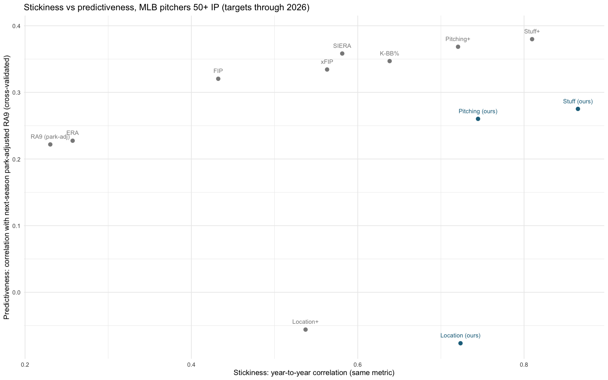

# P1 scorecard

Mode: **final** — targets through 2026 (lockbox open). Generated 2026-11-20.

MLB pitchers; common sample = pitcher-seasons with every metric present. RA9 is park-adjusted.
Season pairs require 50+ IP in both seasons, weighted by the smaller; 659 pitchers qualified in a season and fell below 50 IP (or left MLB) the next.
Predictive errors are cross-validated by pitcher (5 folds), so no pitcher's own outcome fits his prediction.

## Success criteria

P1 grades score every pitch with a model that never saw that pitcher, so they measure pitch quality, not the pitcher's results. Scoring the same pitches with a model that had seen the pitcher raised next-season RA9 correlation from 0.25 to 0.35 (about Stuff+'s level) in a P1 test: the public models' predictive edge comes largely from grades that absorb results. Prediction against Marcel and Pitching+ is therefore judged at P3, where the projection combines grades with results.

- Judged at P3 (grades alone behind) — Pitching (ours) beats Marcel + window RA9 on rest-of-season RA9 RMSE after 100 pitches (1.195 vs 1.182)
- Judged at P3 (grades alone behind) — Pitching (ours) beats Marcel + window RA9 on rest-of-season RA9 RMSE after 250 pitches (1.196 vs 1.193)
- Judged at P3 (grades alone behind) — Pitching (ours) beats Marcel + window RA9 on rest-of-season RA9 RMSE after 500 pitches (1.186 vs 1.175)
- Judged at P3 (grades alone already ahead) — Pitching (ours) beats Marcel on next-season RA9 RMSE (1.054 vs 1.056)
- Judged at P3 (grades alone behind) — Pitching (ours) beats Pitching+ on next-season RA9 RMSE (1.054 vs 1.015)
- Judged at P3 (grades alone behind) — Pitching (ours) adds more than Pitching+ on top of prior RA9 (Δ RMSE -0.0206 vs -0.0514)
- PASS — Stuff (ours) is at least as sticky as Stuff+ (r 0.865 vs 0.810)

## Stickiness: same metric, year y vs y+1

| metric | n | pearson | spearman | r 50-100 | r 100-150 | r 150+ |
|---|---|---|---|---|---|---|
| Stuff (ours) | 1,073 | 0.865 | 0.854 | 0.857 | 0.869 | 0.856 |
| Location (ours) | 1,073 | 0.724 | 0.719 | 0.677 | 0.727 | 0.754 |
| Pitching (ours) | 1,073 | 0.745 | 0.738 | 0.731 | 0.711 | 0.799 |
| ERA | 1,073 | 0.257 | 0.285 | 0.223 | 0.260 | 0.363 |
| FIP | 1,073 | 0.432 | 0.455 | 0.374 | 0.425 | 0.582 |
| xFIP | 1,073 | 0.563 | 0.563 | 0.490 | 0.606 | 0.639 |
| SIERA | 1,073 | 0.581 | 0.588 | 0.549 | 0.591 | 0.608 |
| K-BB% | 1,073 | 0.638 | 0.625 | 0.587 | 0.693 | 0.671 |
| Stuff+ | 1,073 | 0.810 | 0.800 | 0.801 | 0.801 | 0.816 |
| Location+ | 1,073 | 0.537 | 0.526 | 0.502 | 0.518 | 0.564 |
| Pitching+ | 1,073 | 0.721 | 0.707 | 0.696 | 0.715 | 0.768 |
| RA9 (park-adj) | 1,073 | 0.230 | 0.256 | 0.175 | 0.268 | 0.343 |

## Split-half reliability: odd vs even games, same season

| metric | n | pearson | spearman |
|---|---|---|---|
| Location (ours) | 2,059 | 0.782 | 0.764 |
| Pitching (ours) | 2,059 | 0.865 | 0.863 |
| Stuff (ours) | 2,059 | 0.975 | 0.971 |

## Next-season park-adjusted RA9

| metric | n | rmse | pearson | spearman |
|---|---|---|---|---|
| Stuff (ours) | 1,073 | 1.049 | 0.275 | 0.285 |
| Location (ours) | 1,073 | 1.094 | -0.076 | -0.093 |
| Pitching (ours) | 1,073 | 1.054 | 0.260 | 0.274 |
| ERA | 1,073 | 1.063 | 0.227 | 0.256 |
| FIP | 1,073 | 1.034 | 0.320 | 0.337 |
| xFIP | 1,073 | 1.029 | 0.334 | 0.342 |
| SIERA | 1,073 | 1.019 | 0.358 | 0.363 |
| K-BB% | 1,073 | 1.024 | 0.347 | 0.340 |
| Stuff+ | 1,073 | 1.010 | 0.380 | 0.379 |
| Location+ | 1,073 | 1.093 | -0.056 | -0.064 |
| Pitching+ | 1,073 | 1.015 | 0.368 | 0.384 |
| RA9 (park-adj) | 1,073 | 1.064 | 0.222 | 0.249 |
| Marcel | 1,073 | 1.056 | 0.252 | 0.277 |

## Incremental value: added on top of what we already knew

Negative = the metric lowers next-season RA9 error when added.

| metric | Δ RMSE vs prior RA9 | Δ RMSE vs Marcel |
|---|---|---|
| Stuff (ours) | -0.0270 | -0.0230 |
| Location (ours) | -0.0002 | -0.0004 |
| Pitching (ours) | -0.0206 | -0.0173 |
| ERA | -0.0003 | 0.0005 |
| FIP | -0.0290 | -0.0226 |
| xFIP | -0.0355 | -0.0299 |
| SIERA | -0.0445 | -0.0382 |
| K-BB% | -0.0411 | -0.0351 |
| Stuff+ | -0.0574 | -0.0512 |
| Location+ | -0.0006 | -0.0007 |
| Pitching+ | -0.0514 | -0.0449 |

## Rest-of-season park-adjusted RA9 after the first N pitches

Rest of season ≥ 30 IP, weighted by rest-of-season IP. Runs are runs scored while the pitcher was in the game (Statcast has no charged runs).

| N | metric | n | rmse | pearson |
|---|---|---|---|---|
| 100 | Stuff (ours) | 2,569 | 1.179 | 0.190 |
| 100 | Location (ours) | 2,569 | 1.203 | -0.060 |
| 100 | Pitching (ours) | 2,569 | 1.195 | 0.100 |
| 100 | Window RA9 | 2,569 | 1.200 | 0.033 |
| 100 | Window FIP | 2,569 | 1.198 | 0.062 |
| 100 | Window K-BB% | 2,569 | 1.193 | 0.112 |
| 100 | Marcel | 2,569 | 1.183 | 0.168 |
| 100 | Marcel + Window RA9 | 2,569 | 1.182 | 0.176 |
| 100 | Marcel + Pitching (ours) | 2,569 | 1.179 | 0.188 |
| 250 | Stuff (ours) | 2,218 | 1.190 | 0.203 |
| 250 | Location (ours) | 2,218 | 1.215 | 0.047 |
| 250 | Pitching (ours) | 2,218 | 1.196 | 0.180 |
| 250 | Window RA9 | 2,218 | 1.210 | 0.099 |
| 250 | Window FIP | 2,218 | 1.204 | 0.136 |
| 250 | Window K-BB% | 2,218 | 1.196 | 0.177 |
| 250 | Marcel | 2,218 | 1.199 | 0.165 |
| 250 | Marcel + Window RA9 | 2,218 | 1.193 | 0.193 |
| 250 | Marcel + Pitching (ours) | 2,218 | 1.184 | 0.227 |
| 500 | Stuff (ours) | 1,631 | 1.176 | 0.239 |
| 500 | Location (ours) | 1,631 | 1.212 | 0.009 |
| 500 | Pitching (ours) | 1,631 | 1.186 | 0.202 |
| 500 | Window RA9 | 1,631 | 1.194 | 0.165 |
| 500 | Window FIP | 1,631 | 1.188 | 0.194 |
| 500 | Window K-BB% | 1,631 | 1.169 | 0.261 |
| 500 | Marcel | 1,631 | 1.189 | 0.189 |
| 500 | Marcel + Window RA9 | 1,631 | 1.175 | 0.240 |
| 500 | Marcel + Pitching (ours) | 1,631 | 1.172 | 0.251 |

## Pitch models: 2026 held out (trained on 2023–2025)

| model | n_test | metric | value | baseline |
|---|---|---|---|---|
| stuff | 712,122 | rmse | 0.1589 | 0.1592 |
| location | 712,122 | rmse | 0.1538 | 0.1592 |
| pitching | 712,122 | rmse | 0.1533 | 0.1592 |
| stuff_physics | 712,122 | rmse | 0.1589 | 0.1592 |
| pitching_noseq | 712,122 | rmse | 0.1533 | 0.1592 |
| p_swing | 712,122 | logloss | 0.4450 | 0.6921 |
| p_whiff | 339,714 | logloss | 0.4250 | 0.5382 |
| p_cstrike | 372,408 | logloss | 0.1297 | 0.6189 |
| xwoba_contact | 122,781 | rmse | 0.3752 | 0.3811 |
| p_gb | 123,952 | logloss | 0.6292 | 0.6816 |

Calibration by pitch type × count (cells with 2,000+ pitches):

| model | cells | max_abs_error |
|---|---|---|
| location | 75 | 0.0134 |
| p_cstrike | 55 | 0.0545 |
| p_gb | 24 | 0.0439 |
| p_swing | 75 | 0.0537 |
| p_whiff | 59 | 0.0294 |
| pitching | 75 | 0.0136 |
| pitching_noseq | 75 | 0.0131 |
| stuff | 75 | 0.0104 |
| stuff_physics | 75 | 0.0104 |
| xwoba_contact | 24 | 0.0244 |

